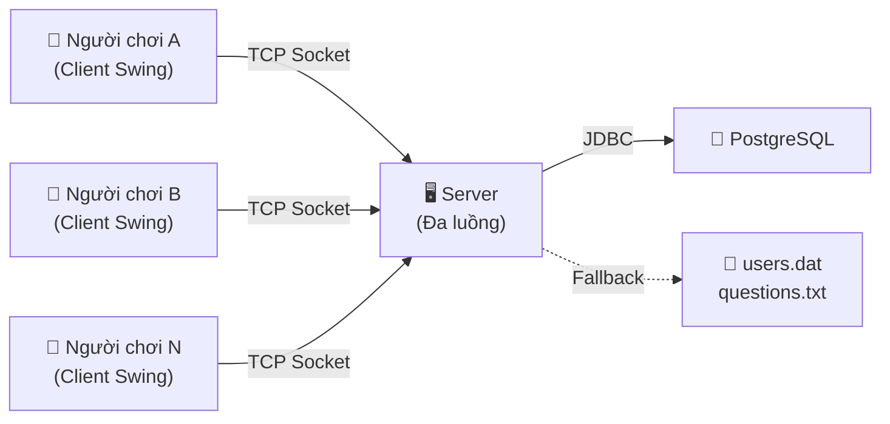
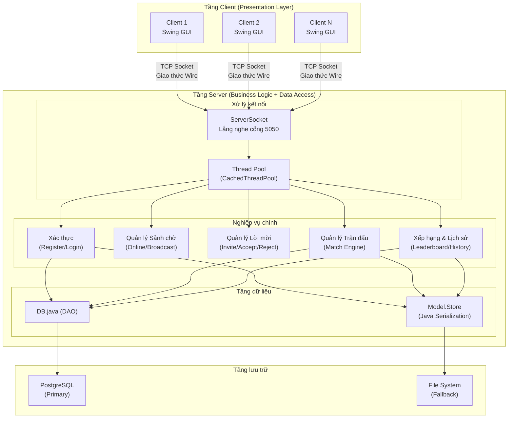
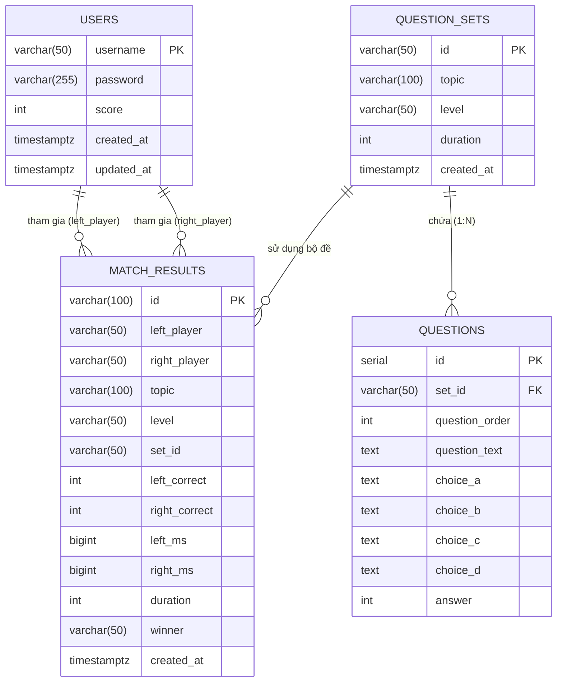
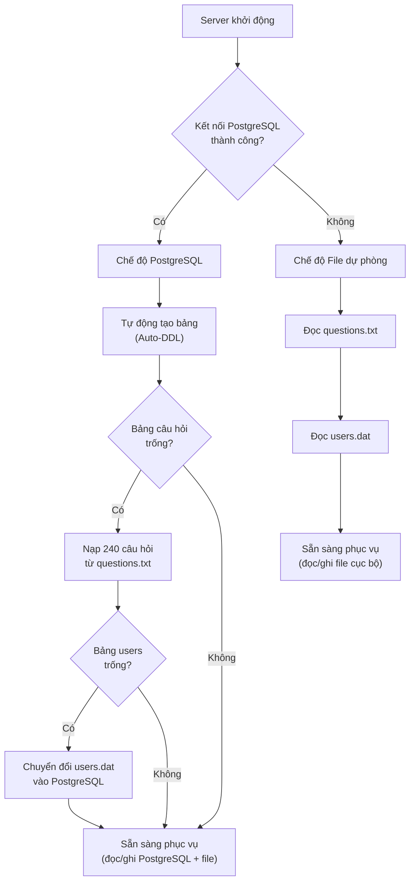
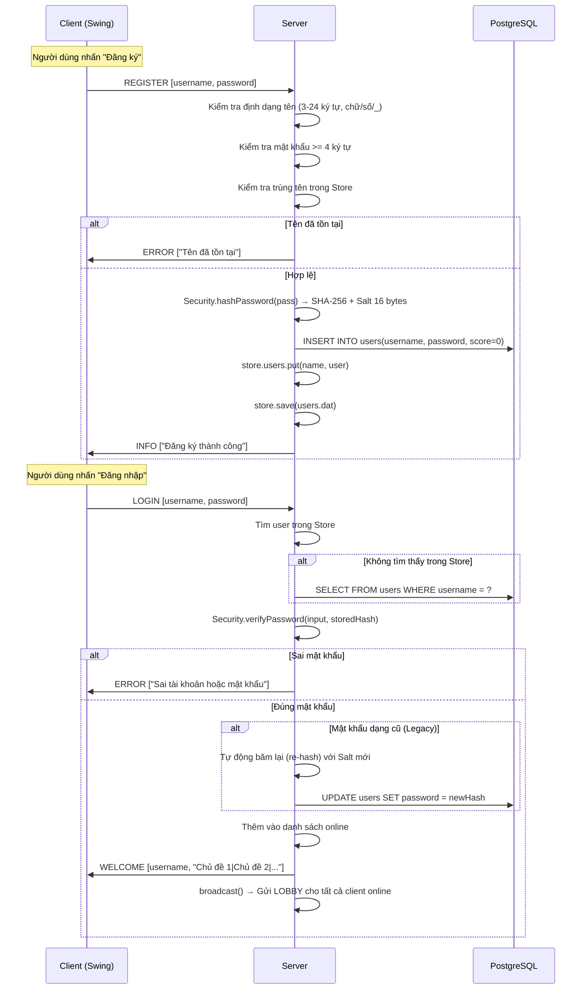
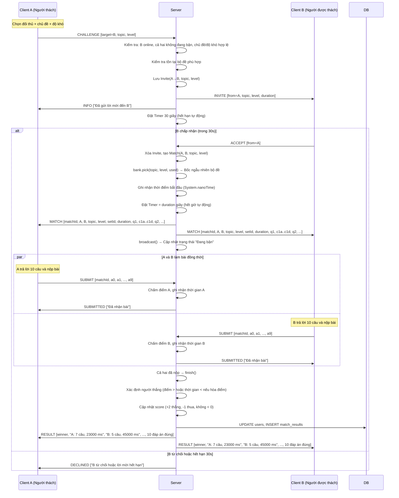
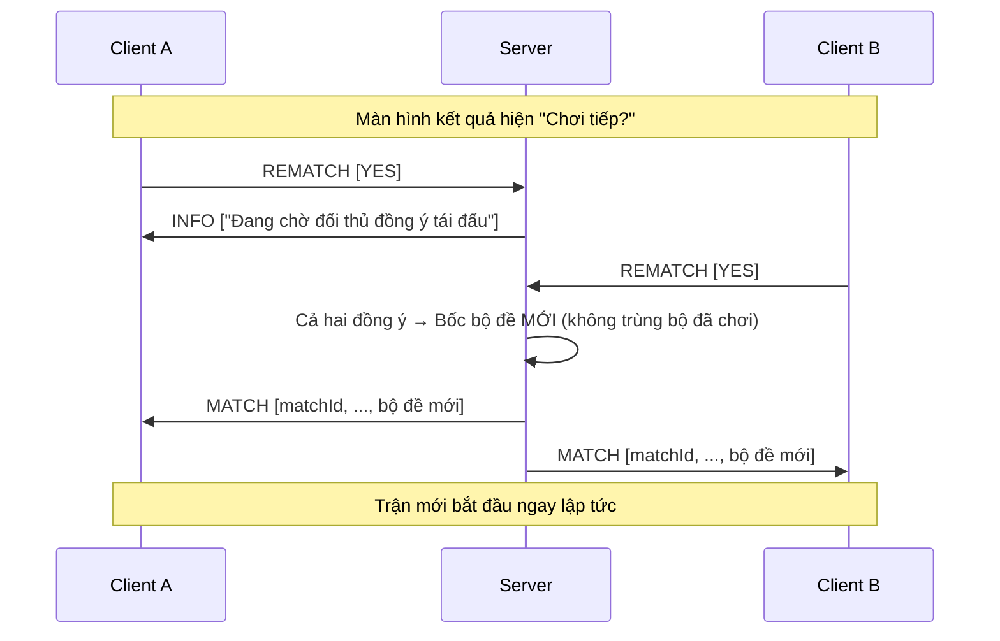
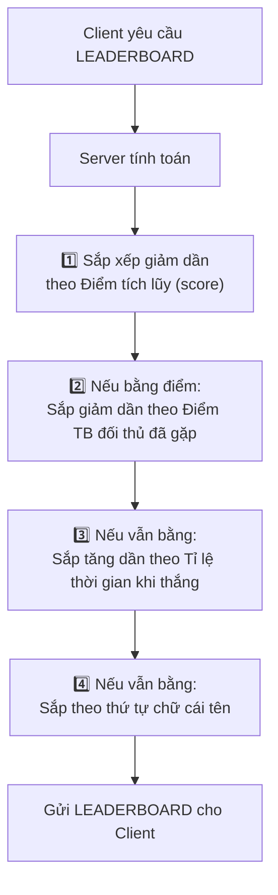
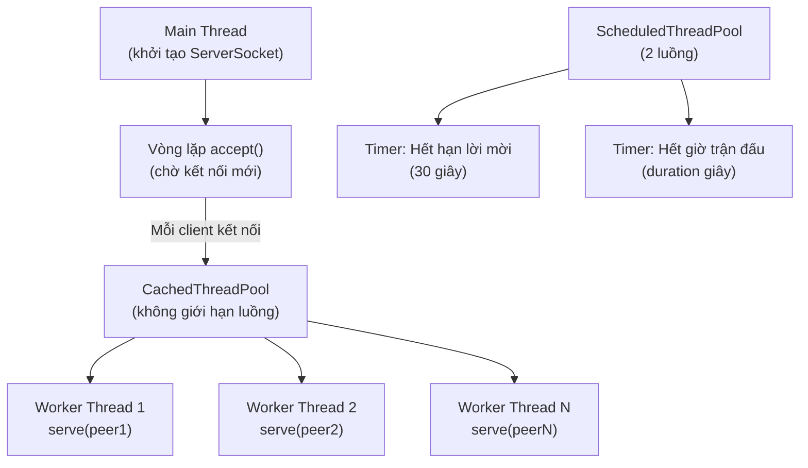
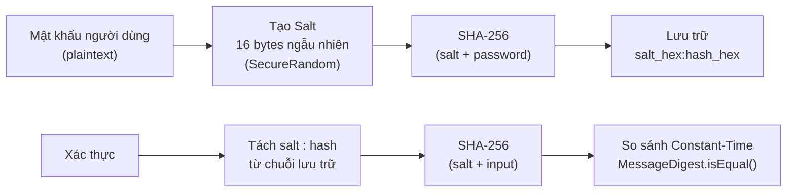

# ĐẶC TẢ HỆ THỐNG — GAME TRẮC NGHIỆM ĐỐI KHÁNG 1V1 (QUIZ ARENA)

> **Đề tài Nhóm 5 — Lập Trình Mạng**
> Học viện Công nghệ Bưu chính Viễn thông (PTIT)
> Java 17 · TCP Socket · Swing · PostgreSQL

---

## 1. TỔNG QUAN DỰ ÁN

### 1.1 Mô tả

Quiz Arena là ứng dụng game trắc nghiệm đối kháng thời gian thực 1 chọi 1 (1v1) trên mạng LAN/Internet, xây dựng hoàn toàn bằng Java 17. Hệ thống cho phép nhiều người chơi đồng thời đăng nhập vào một máy chủ trung tâm, thách đấu nhau theo chủ đề và độ khó, cùng làm 10 câu hỏi trắc nghiệm giới hạn thời gian, với việc chấm điểm và tính thời gian hoàn toàn tại phía server để đảm bảo công bằng tuyệt đối.

### 1.2 Mục tiêu kỹ thuật

| STT | Mục tiêu | Công nghệ áp dụng |
|-----|----------|--------------------|
| 1 | Lập trình mạng Socket TCP nhiều luồng | `java.net.ServerSocket`, `java.net.Socket`, `ExecutorService` |
| 2 | Giao tiếp nhị phân Client–Server thời gian thực | `DataInputStream` / `DataOutputStream` (giao thức tùy chỉnh `Wire`) |
| 3 | Giao diện đồ họa hiện đại | Java Swing + Bảng màu Kahoot-inspired |
| 4 | Bảo mật mật khẩu chuẩn mật mã học | SHA-256 với Salt 16 bytes ngẫu nhiên |
| 5 | Hệ quản trị CSDL quan hệ | PostgreSQL 16+ qua JDBC |
| 6 | Cơ chế dự phòng không gián đoạn | Fallback từ PostgreSQL sang file cục bộ (Fault Tolerance) |

### 1.3 Các bên tham gia (Actors)



---

## 2. KIẾN TRÚC HỆ THỐNG

### 2.1 Mô hình kiến trúc tổng quan

Hệ thống áp dụng mô hình **Client–Server 2 tầng (2-Tier)** với kiến trúc **Concurrent Multi-threaded Server**:



### 2.2 Phân lớp thành phần (Component Diagram)

#### Phía Server (Package `quiz`)

| Thành phần | File | Trách nhiệm |
|------------|------|-------------|
| **Server** | `Server.java` | Lõi nghiệp vụ: lắng nghe TCP, xử lý đa luồng, quản lý sảnh online, lời mời, trận đấu, chấm bài, tính điểm, xếp hạng |
| **Server.Peer** | (inner class) | Đại diện cho một kết nối client: đóng gói Socket + luồng I/O |
| **Server.Match** | (inner class) | Máy trạng thái (State Machine) cho một trận đấu 1v1: bốc đề → gửi đề → nhận bài → chấm điểm → xác định kết quả → tái đấu |
| **Server.Invite** | (record) | Dữ liệu lời mời thách đấu giữa hai người chơi |
| **Wire** | `Wire.java` | Giao thức truyền thông nhị phân tùy chỉnh: đóng gói và giải mã các gói tin qua DataStream |
| **Model** | `Model.java` | Lớp dữ liệu chung: `Question`, `SetData`, `User`, `Result`, `Store` |
| **Bank** | `Bank.java` | Ngân hàng câu hỏi: phân tích, xác thực và quản lý 240 câu hỏi (từ PostgreSQL hoặc file) |
| **Security** | `Security.java` | Băm mật khẩu SHA-256 + Salt, xác thực thời gian hằng số (Constant-time), tương thích ngược |
| **DB** | `DB.java` | Lớp truy cập dữ liệu (DAO): kết nối JDBC PostgreSQL, tự động tạo bảng (Auto-DDL), tự động nạp dữ liệu (Auto-Seed), các phương thức CRUD |

#### Phía Client (Package `quiz` + `quiz.ui`)

| Thành phần | File | Trách nhiệm |
|------------|------|-------------|
| **Client** | `Client.java` | Điều phối giao diện: kết nối Socket, nhận/gửi gói tin, điều hướng màn hình |
| **AuthScreen** | `AuthScreen.java` | Màn hình đăng nhập / đăng ký |
| **LobbyScreen** | `LobbyScreen.java` | Sảnh chờ: danh sách người chơi online, bộ lọc chủ đề/độ khó, thách đấu |
| **MatchScreen** | `MatchScreen.java` | Màn hình thi đấu: 10 câu hỏi, đồng hồ đếm ngược, 4 nút đáp án, emote |
| **ResultDialog** | `ResultDialog.java` | Hộp thoại kết quả: Thắng/Thua/Hòa, tái đấu |
| **ReviewAnswersDialog** | `ReviewAnswersDialog.java` | Xem chi tiết đáp án đúng/sai sau trận |
| **InviteDialog** | `InviteDialog.java` | Hộp thoại nhận lời mời thách đấu (đếm ngược 30s) |
| **LeaderboardDialog** | `LeaderboardDialog.java` | Bảng xếp hạng tổng |
| **HistoryDialog** | `HistoryDialog.java` | Lịch sử trận đấu cá nhân |
| **LeaderboardPanel** / **HistoryPanel** | `LeaderboardPanel.java`, `HistoryPanel.java` | Giao diện dạng panel cho Bảng xếp hạng và Lịch sử |
| **Navigation** | `NavigationBar.java`, `NavigationTab.java` | Thanh điều hướng chuyển đổi tab (Sảnh chờ, BXH, Lịch sử) |
| **Feedback UI** | `ToastManager.java`, `DisconnectOverlay.java` | Hiển thị thông báo (toast) và giao diện mất kết nối mạng |
| **Theme** | `Theme.java` | Hệ thống thiết kế: bảng màu, font chữ, bo tròn |
| **SoundManager** | `SoundManager.java` | Tổng hợp âm thanh PCM thời gian thực (không cần file ngoài) |

---

## 3. GIAO THỨC TRUYỀN THÔNG (WIRE PROTOCOL)

### 3.1 Định dạng gói tin

Giao thức sử dụng **Binary Framed Protocol** tùy chỉnh trên nền TCP, không dựa trên HTTP hay WebSocket:

```
┌──────────────────┬───────────────┬───────────────┬─────┬───────────────┐
│ Số lượng trường   │ Trường 1      │ Trường 2      │ ... │ Trường N      │
│ (int, 4 bytes)   │ (UTF string)  │ (UTF string)  │     │ (UTF string)  │
└──────────────────┴───────────────┴───────────────┴─────┴───────────────┘
```

- **Đọc**: `DataInputStream.readInt()` → lặp `readUTF()` theo số lượng trường.
- **Ghi**: `DataOutputStream.writeInt(n)` → lặp `writeUTF(field)` → `flush()`.
- **Đồng bộ**: Phương thức `send()` được `synchronized` trên luồng output để tránh xung đột khi nhiều thread cùng gửi.

### 3.2 Bảng các loại gói tin (Message Types)

#### Client → Server

| Gói tin | Trường | Mô tả |
|---------|--------|-------|
| `REGISTER` | `[username, password]` | Đăng ký tài khoản mới |
| `LOGIN` | `[username, password]` | Đăng nhập |
| `CHALLENGE` | `[target, topic, level]` | Gửi lời mời thách đấu |
| `ACCEPT` | `[from]` | Chấp nhận lời mời |
| `REJECT` | `[from]` | Từ chối lời mời |
| `SUBMIT` | `[matchId, a0, a1, ..., a9]` | Nộp bài (10 đáp án 0–3 hoặc -1) |
| `REMATCH` | `[YES/NO]` | Bỏ phiếu tái đấu |
| `LEAVE` | `[]` | Rời trận đấu |
| `EMOTE` | `[emoji]` | Gửi biểu cảm cho đối thủ |
| `LEADERBOARD` | `[]` | Yêu cầu bảng xếp hạng |
| `HISTORY` | `[]` | Yêu cầu lịch sử cá nhân |

#### Server → Client

| Gói tin | Trường | Mô tả |
|---------|--------|-------|
| `WELCOME` | `[username, topics]` | Đăng nhập thành công (kèm danh sách chủ đề phân cách `\|`) |
| `INFO` | `[message]` | Thông báo trung tính |
| `ERROR` | `[message]` | Thông báo lỗi |
| `LOBBY` | `[data]` | Cập nhật sảnh: `name;score;status\|name;score;status\|...` |
| `INVITE` | `[from, topic, level, questions, duration]` | Lời mời thách đấu (kèm thời gian trận) |
| `DECLINED` | `[reason]` | Lời mời bị từ chối / hết hạn |
| `MATCH` | `[matchId, left, right, topic, level, setId, duration, q1, c1a, c1b, c1c, c1d, ...]` | Bắt đầu trận (58 trường: 8 header + 10×5 câu hỏi) |
| `SUBMITTED` | `[message]` | Xác nhận server đã nhận bài |
| `RESULT` | `[winner, leftInfo, rightInfo, prompt, a0, a1, ..., a9]` | Kết quả trận (15 trường: 5 thông tin + 10 đáp án đúng) |
| `EMOTE` | `[from, emoji]` | Chuyển tiếp biểu cảm từ đối thủ |
| `CLOSED` | `[reason]` | Trận đấu kết thúc / phòng bị đóng |
| `LEADERBOARD` | `[data]` | Dữ liệu bảng xếp hạng |
| `HISTORY` | `[data]` | Dữ liệu lịch sử cá nhân |

---

## 4. THIẾT KẾ CƠ SỞ DỮ LIỆU

### 4.1 Mô hình quan hệ thực thể (ERD)



### 4.2 Chiến lược lưu trữ kép (Dual Storage Strategy)



> **Nguyên tắc**: Khi PostgreSQL khả dụng, mỗi thao tác ghi (đăng ký, cập nhật điểm, lưu kết quả) được ghi đồng thời vào cả PostgreSQL **và** file `users.dat` để đảm bảo tính nhất quán.

---

## 5. LUỒNG HOẠT ĐỘNG (ACTIVITY FLOWS)

### 5.1 Luồng Đăng ký & Đăng nhập



### 5.2 Luồng Thách đấu & Thi đấu 1v1



### 5.3 Luồng Tái đấu (Rematch)



### 5.4 Luồng Xếp hạng (Leaderboard)



---

## 6. MÔ HÌNH LUỒNG XỬ LÝ ĐA LUỒNG (CONCURRENCY MODEL)

### 6.1 Sơ đồ luồng (Thread Model)



### 6.2 Cơ chế đồng bộ hóa (Synchronization)

| Tài nguyên chia sẻ | Cơ chế bảo vệ | Lý do |
|--------------------|---------------|-------|
| `online` (Map người chơi) | `ConcurrentHashMap` | Nhiều worker thread đồng thời thêm/xóa người chơi |
| `matches` (Map trận đấu) | `ConcurrentHashMap` | Truy cập từ nhiều worker và timer thread |
| `invites` (Map lời mời) | `ConcurrentHashMap` | Thao tác từ cả hai phía người gửi và người nhận |
| `store` (dữ liệu users + results) | `synchronized(store)` | Đảm bảo tính nguyên tử khi đọc/ghi đồng thời |
| `Match` (trạng thái trận đấu) | `synchronized` trên từng phương thức | Hai người chơi nộp bài cùng lúc + timer hết giờ |
| `DataOutputStream` | `synchronized(out)` trong `Wire.send()` | Tránh xen kẽ byte khi gửi gói tin từ nhiều luồng |

---

## 7. BẢO MẬT

### 7.1 Mô hình băm mật khẩu



### 7.2 Các biện pháp bảo mật

| Biện pháp | Chi tiết |
|-----------|---------|
| **Chống tấn công từ điển (Dictionary Attack)** | Mỗi tài khoản có Salt 16 bytes ngẫu nhiên riêng, không thể dùng bảng Rainbow |
| **Chống tấn công thời gian (Timing Attack)** | Sử dụng `MessageDigest.isEqual()` — so sánh trong thời gian hằng số |
| **Tương thích ngược (Backward Compatibility)** | Mật khẩu cũ dạng plaintext được nhận diện qua `isLegacy()` và tự động nâng cấp (re-hash) ngay khi đăng nhập thành công |
| **Chống gian lận đáp án** | Đáp án đúng **KHÔNG** được gửi cho client trong gói `MATCH`. Chỉ gửi sau khi trận kết thúc trong gói `RESULT` |
| **Tính toán thời gian tại Server** | `System.nanoTime()` được gọi hoàn toàn tại server, client không thể giả mạo thời gian làm bài |

---

## 8. NGÂN HÀNG CÂU HỎI

### 8.1 Cấu trúc dữ liệu

| Thông số | Giá trị |
|----------|---------|
| Tổng số câu hỏi | 240 |
| Số chủ đề | 4 (Mạng máy tính, Lập trình & CTDL, Khoa học & Đời sống, Lịch sử & Địa lý) |
| Số cấp độ | 3 (Dễ: 100s, Trung bình: 150s, Khó: 200s) |
| Số bộ đề mỗi cấp | 2 bộ đề độc lập |
| Số câu mỗi bộ | 10 câu × 4 phương án |
| Tổng bộ đề | 4 × 3 × 2 = **24 bộ đề** |

### 8.2 Thuật toán bốc đề

```
1. Lọc tất cả bộ đề khớp (chủ đề, cấp độ)
2. Loại bỏ các bộ đã dùng trong phòng đấu hiện tại
3. Nếu không còn bộ mới → Reset danh sách đã dùng
4. Chọn ngẫu nhiên 1 bộ từ danh sách còn lại
```

> **Ý nghĩa**: Khi hai người chơi tái đấu liên tục trong cùng phòng, họ sẽ KHÔNG gặp lại bộ đề đã làm cho đến khi đã làm hết tất cả các bộ.

---

## 9. QUY TẮC TÍNH ĐIỂM & XẾP HẠNG

### 9.1 Tính điểm trận đấu

| Tình huống | Kết quả |
|-----------|---------|
| Đúng nhiều câu hơn | **Thắng** |
| Bằng số câu đúng + chênh lệch thời gian > 1 giây | Nộp sớm hơn → **Thắng** |
| Bằng số câu đúng + chênh lệch thời gian ≤ 1 giây | **Hòa** |
| Hết giờ chưa nộp bài | Tính 0 câu đúng, thời gian = duration × 1000 ms |
| Ngắt kết nối giữa trận | Tính 0 câu đúng, thời gian tối đa |

### 9.2 Cập nhật điểm xếp hạng

| Kết quả | Người thắng | Người thua |
|---------|-------------|------------|
| Thắng/Thua | +2 điểm | −1 điểm (không xuống dưới 0) |
| Hòa | Không đổi | Không đổi |

---

## 10. TỔNG KẾT CẤU TRÚC THƯ MỤC DỰ ÁN

```
QuizDoiKhang/
├── pom.xml                     # Cấu hình Maven + PostgreSQL JDBC dependency
├── schema_postgres.sql         # Script DDL tạo 4 bảng PostgreSQL
├── run-server.bat              # Script khởi chạy Server
├── run-client.bat              # Script khởi chạy Client
├── data/
│   ├── db.properties           # Cấu hình kết nối PostgreSQL
│   ├── questions.txt           # Ngân hàng 240 câu hỏi (nguồn dữ liệu gốc)
│   └── users.dat               # File lưu trữ dự phòng (Java Serialization)
├── lib/
│   └── postgresql-42.7.3.jar   # JDBC Driver cho PostgreSQL
├── src/quiz/
│   ├── Server.java             # Server TCP đa luồng (lõi nghiệp vụ)
│   ├── Client.java             # Client Swing (điều phối giao diện)
│   ├── Wire.java               # Giao thức truyền thông nhị phân
│   ├── Model.java              # Các lớp dữ liệu chung
│   ├── Bank.java               # Ngân hàng câu hỏi
│   ├── Security.java           # Bảo mật mật khẩu SHA-256 + Salt
│   ├── DB.java                 # Lớp truy cập dữ liệu PostgreSQL (DAO)
│   └── ui/                     # 31 file giao diện Swing hiện đại
│       ├── Theme.java          #   Hệ thống thiết kế (màu sắc, font)
│       ├── AuthScreen.java     #   Màn hình xác thực
│       ├── LobbyScreen.java    #   Sảnh chờ online
│       ├── MatchScreen.java    #   Màn hình thi đấu
│       ├── NavigationBar.java  #   Thanh điều hướng
│       ├── ToastManager.java   #   Hệ thống thông báo nhanh
│       ├── DisconnectOverlay.java # Giao diện khi mất mạng
│       ├── ResultDialog.java   #   Kết quả & tái đấu
│       ├── SoundManager.java   #   Âm thanh tổng hợp PCM
│       └── ...                 #   (các component UI khác)
└── tests/
    ├── TestPostgreSQL.java     # Kiểm thử kết nối PostgreSQL
    ├── TestE2E.java            # Kiểm thử tích hợp toàn diện
    ├── TestPhase7.java         # Kiểm thử ngân hàng câu hỏi
    └── ...                     # (các bộ test khác)
```
